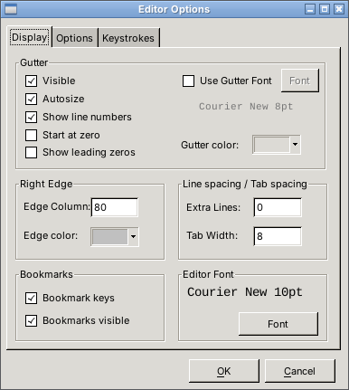
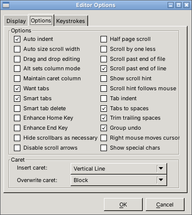
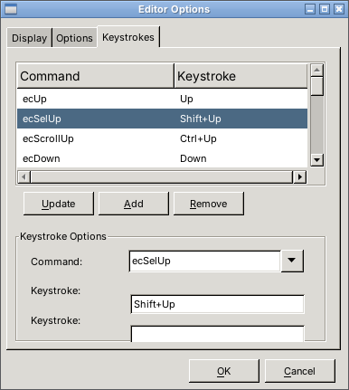
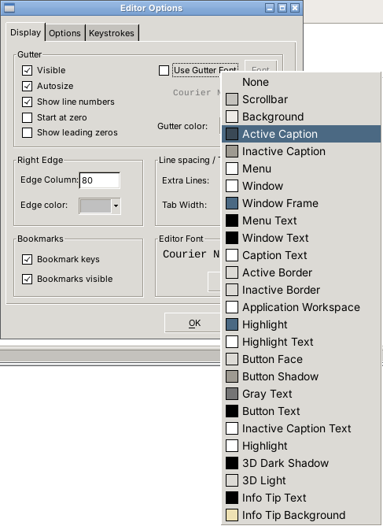
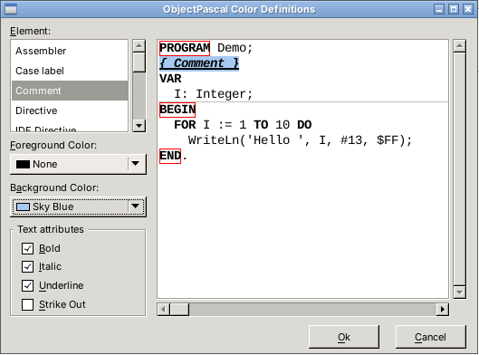

# SynDialogs for Lazarus

A Lazarus port of two Delphi SynEdit units that Lazarus SynEdit does not provide:

| Unit | Window | Component |
|------|--------|-----------|
| `SynEditOptionsDialog` | Editor options (display, options, keystrokes) | `TSynEditOptionsDialog` + `TSynEditorOptionsContainer` |
| `SynColorDialogForm` | Highlighter colors and font styles | `TSynColorDialog` |

The class names, component names, form layout and public API match the Delphi originals, so existing Delphi code keeps working with only minor changes.

## Screenshots

*Captured with the demo on Linux (GTK2); on Windows the dialogs use the native Windows look.*

### Editor options window

| Display | Options | Keystrokes |
|:-------:|:-------:|:----------:|
|  |  |  |

System colors popup of the gutter and right edge color buttons:



### Highlighter colors window



## Contents

```
SynDialogs/
├── README.md
├── LICENSE                           Mozilla Public License 1.1
├── .gitignore                        Lazarus build output (lib/, backup/, *.res, *.lps…)
├── SynEditOptionsDialog.pas / .lfm   Editor options window
├── SynColorDialogForm.pas / .lfm     Highlighter colors window
├── Screenshots/                      Images used in this README
└── Demo/
    ├── SynDialogsDemo.lpi / .lpr     Demo project
    └── uDemo.pas / .lfm              SynEdit + Pascal highlighter + 2 buttons
```

## Requirements

- Lazarus 3.x or later (tested with Lazarus 3.0 / FPC 3.2.2)
- Packages: `SynEdit`, `LCL`
- No third-party library (JVCL is not needed)

## Installation

Copy the four unit files (`.pas` + `.lfm`) into your project folder, or add their folder to *Project Options → Compiler Options → Paths → Other unit files*. Then add the units to your `USES` clause:

```pascal
USES
  SynEditOptionsDialog, SynColorDialogForm;
```

Both units also contain a `Register` procedure (palette page **SynEdit**). You can add them to your own design-time package if you want the components on the palette; otherwise just create them in code.

## Usage

### Editor options window

```pascal
PROCEDURE TfrmMain.btnOptionsClick(Sender: TObject);
// Edit the options of SynEdit1
VAR
  Opt: TSynEditorOptionsContainer;
  Dlg: TSynEditOptionsDialog;
BEGIN
  Opt := TSynEditorOptionsContainer.Create(NIL);
  Dlg := TSynEditOptionsDialog.Create(NIL);
  TRY
    Opt.Assign(SynEdit1);          // editor -> container
    IF Dlg.Execute(Opt) THEN
      Opt.AssignTo(SynEdit1);      // container -> editor
  FINALLY
    Dlg.Free;
    Opt.Free;
  END;
END;
```

The container can be applied to several editors (`Opt.AssignTo(SynEdit2)`, …) and, since it is a `TComponent` with published properties, it can be streamed or saved to an ini file.

#### Display tab
- **Gutter**: visible, autosize, show line numbers, start at zero, leading zeros, gutter font, gutter color.
- **Right edge**: edge column and edge color.
- **Line spacing / Tab spacing**: extra lines, tab width.
- **Bookmarks**: bookmark keys, bookmarks visible.
- **Editor font**: fixed-pitch font dialog.

The color buttons open a popup with the 25 Windows system colors (with color swatches) plus *None*; clicking the color itself opens the standard color dialog.

#### Options tab
24 check boxes with hints: auto indent, auto size scroll width, drag and drop editing, Alt sets column mode, maintain caret column, want tabs, smart tabs, smart tab delete, enhance Home key, enhance End key, hide scrollbars as necessary, disable scroll arrows, half page scroll, scroll by one less, scroll past end of file, scroll past end of line, show scroll hint, scroll hint follows mouse, tab indent, tabs to spaces, trim trailing spaces, group undo, right mouse moves cursor, show special chars.

**Caret**: insert and overwrite caret shapes (vertical line, horizontal line, half block, block).

#### Keystrokes tab
- List of all keystrokes (command and shortcut).
- **Update**, **Add**, **Remove** buttons.
- Command combo with incremental completion; Enter = Update.
- Two shortcut edits (first key and optional second key of a two-key combination). Press the key combination you want, it is captured as is (Tab, arrows, Enter and Escape included).
- Edits are made on a copy and stored only when you click **OK**.

#### Dialog properties

| Property | Description |
|----------|-------------|
| `UseExtendedStrings` | Show readable names (`Select Line Start`) instead of identifiers (`ecSelLineStart`). |
| `GetUserCommand` | Event returning the name of a user command (`Command >= ecUserFirst`). |
| `GetAllUserCommands` | Event adding user commands to the command list (`AddObject(Name, TObject(PtrInt(Cmd)))`). |
| `Form` | Direct access to the `TfmEditorOptionsDialog` form. |

#### Container defaults

Same as the Delphi container: Courier New 8, `clWindow`, right edge 80 (`clSilver`), tab width 8, max undo 1024, want tabs, vertical line insert caret, block overwrite caret, options `[eoAutoIndent, eoDragDropEditing, eoDropFiles, eoScrollPastEol, eoShowScrollHint, eoSmartTabs, eoAltSetsColumnMode, eoTabsToSpaces, eoTrimTrailingSpaces, eoKeepCaretX]`, default keystrokes.

### Highlighter colors window

```pascal
PROCEDURE TfrmMain.btnColorsClick(Sender: TObject);
// Edit the colors of SynEdit1's highlighter
VAR
  Dlg: TSynColorDialog;
BEGIN
  Dlg := TSynColorDialog.Create(NIL);
  TRY
    Dlg.Execute(SynEdit1);
  FINALLY
    Dlg.Free;
  END;
END;
```

- The list on the left shows the attributes of the highlighter (comment, keyword, string, …).
- For the selected attribute: foreground color, background color, bold, italic, underline, strike out.
- The preview on the right is updated live.
- **Delete** in a color combo sets the color to *None* (`clNone`, default color).
- The highlighter is edited on a copy; it is assigned back to the editor's highlighter only on **OK**. `Execute` returns `True` on OK.
- The window caption is `<LanguageName> Color Definitions`.

## Differences from the Delphi version

### Imposed by Lazarus SynEdit

| Topic | Delphi | Lazarus port |
|-------|--------|--------------|
| `Gutter` property of the container | `TSynGutter` | `TSynEditorOptionsGutter` (a Lazarus `TSynGutter` cannot exist without its editor). Same properties: `Visible`, `AutoSize`, `Width`, `Color`, `ShowLineNumbers`, `LeadingZeros`, `ZeroStart`, `DigitCount`, `UseFontStyle`, `Font`. |
| Gutter font | Separate font | The Lazarus gutter always uses the editor font. With *Use Gutter Font*, only the font **color and style** are applied to the line numbers. |
| Gutter color | Gutter background | Also applied to the background of each gutter part (Lazarus parts paint their own background). |
| `eoEnhanceEndKey` | `Options` | `Options2` — the container has an extra `Options2` property. |
| `MaxScrollWidth` | Applied | Kept in the container but not applied (no such property in Lazarus). |
| `TSynHotKey` | SynEdit control | Not in Lazarus SynEdit: implemented in `SynEditOptionsDialog`. |
| `TJvColorComboBox` | JVCL | LCL `TColorBox` (standard, extended and system colors, *None*, *Custom…*). |
| Preview text | `Highlighter.SampleSource` | Same, but when the highlighter has no sample (e.g. `TSynPasSyn` in Lazarus), the text of the edited SynEdit is shown. |
| Bookmark options | `Assign` | Copied property by property (`TSynBookMarkOpt` has no `Assign` in Lazarus). |

### Delphi bugs fixed

- Keystroke changes were applied immediately to the container, even on **Cancel**. They are now stored only on **OK**.
- *Scroll hint follows mouse* was not mapped to any option; it now sets `eoScrollHintFollows`.
- The hints of *Auto size scroll width* and *Enhance End Key* were wrong.
- `TSynColorDialog.Execute` created its exception without raising it; `EInvalidOperation` is now raised when the SynEdit or its highlighter is not assigned.
- A duplicate shortcut shows an error message instead of an unhandled exception.

## Important note: SynEdit without keystrokes

A `TSynEdit` loaded from an `.lfm` that does not contain a `Keystrokes` section (hand-written or converted forms) has **no keystrokes at all**: arrows, Ctrl+Home, Ctrl+C, … do nothing, and the Keystrokes tab is empty. Restore the defaults once at startup:

```pascal
IF SynEdit1.Keystrokes.Count = 0 THEN
  SynEdit1.Keystrokes.ResetDefaults;
```

The demo does this in `FormCreate`.

## Demo

Open `Demo/SynDialogsDemo.lpi`, build and run. The form contains a SynEdit with the Pascal highlighter and two buttons, **Options...** and **Colors...**.

## License

The original Delphi units are part of the SynEdit project, dual-licensed under the Mozilla Public License 1.1 and the GNU General Public License 2 or later. This port is distributed under the same terms:

- **MPL 1.1**: see the [LICENSE](LICENSE) file.
- **GPL 2 or later**: you may instead use these files under the GPL, as stated in the header of each unit.

The software is provided "AS IS", without warranty of any kind.
